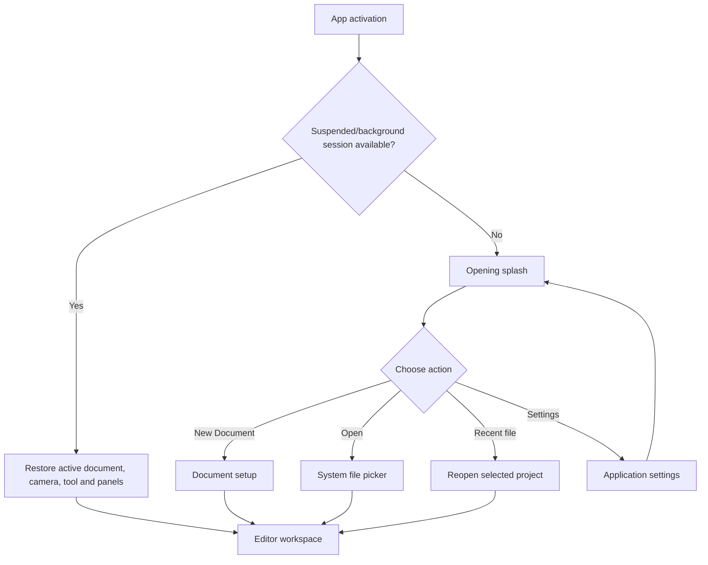

# Ex-Tempore Creare — Application Standard

**Document:** `applicationstandard.md`  
**Status:** Proposed alpha behavior specification  
**Draft version:** `0.1.0`  
**Related documents:** `ui-spec_v8.MD` (existing workspace control contract), `filestandard.md` (`.etc` document and `.etcr` reference containers)

## 1. Scope and principles

This document governs **startup, session resume, new-document creation, infinite-canvas navigation, and export-region workflows**. It complements—not supersedes—the established rotary and layer/filter standards.

- Tablet-first, low-overhead interface; preserve screen space for artwork.
- Do not introduce a permanent duplicate toolbar or inspector.
- Export regions are **editable document objects**, not raster pixels and not layer-stack nodes.
- Dot grid, handles, guides, selection highlights and floating export controls are **UI overlays only**; they do not appear in exported artwork unless a separate explicit operation converts them into artwork.
- Changes to document geometry and export-slice definitions participate in Undo/Redo and document saves.

`MUST` = alpha requirement; `SHOULD` = strong recommendation; `MAY` = later feature.

## 2. Launch, splash and resume

### 2.1 Startup routing



- **Cold launch:** MUST show splash immediately; no extra intro, tutorial or loading animation unless loading is necessary.
- **Tab out / minimize / sleep / suspend:** MUST preserve the current editor, document, selected tool, panel positions, viewport and unsaved changes. On foreground, restore straight to the workspace, **not** the splash.
- **OS-terminated background session:** SHOULD restore from the newest valid recovery checkpoint without overwriting the last committed document. Recovery failures MUST be surfaced instead of silently starting an empty canvas.
- **Explicit document close / return Home:** return to splash; do not mistake an intentional close for a resumable session.
- Save recovery checkpoints on visibility change, app background/suspend, pagehide/close, and periodic idle checkpoints. A background handler SHOULD commit a compact snapshot immediately; OS termination may interrupt long writes, so the prior valid snapshot MUST remain intact.
- Document changes MUST NOT be discarded simply because the user switches apps. The separate `.etcr` reference-board camera and images follow the existing reference persistence contract.

### 2.2 Splash composition

**Exact primary actions:** `New Document` | `Open`.

- Show **up to ten actual recent saved projects** in a **2 × 5 tile grid on tablet landscape** (five columns, two rows), ordered by most recently saved/used, newest first.
- Each tile SHOULD display an artwork thumbnail, filename/title and a compact last-modified indicator. A missing file shows its original thumbnail with **Locate / Remove from recents**; never silently delete its record.
- If fewer than ten exist, show only those files or unobtrusive placeholders, never synthetic recent projects.
- `Settings` remains a distinct control below the recent-file area.
- The ten-item limit applies to the **displayed recent list**, not to the number of documents the user may save.
- Smaller/narrower screens MAY reflow to fewer columns while retaining the same order and ten-item cap.
- File permissions and locations must respect platform file-provider semantics; recent entries require usable persistent handles/bookmarks when supported. A stored string path alone may not grant access on mobile.

## 3. New Document dialog

Show after `New Document`, not on every cold launch.

| Field | Alpha behavior |
| --- | --- |
| Document name | Editable, defaults to `Untitled` |
| Canvas mode | **Finite** or **Infinite** |
| Width / Height | For finite canvas, positive numbers with selectable `px`, `in`, `cm`, `mm` units; show equivalent pixel dimensions |
| Resolution | PPI/DPI, positive number; used to convert physical units and calculate export pixels |
| Presets | E.g. custom, 1920×1080, 2048×2048, A4, US Letter; presets populate editable controls |
| Orientation | Portrait/landscape swap for finite presets |
| Colour mode/profile | From `filestandard.md`: sRGB default, other supported ICC-backed RGB/greyscale/CMYK working profiles |
| Bit depth | Available sample depth consistent with selected profile and supported renderer |
| Background | Transparent or selectable solid colour |
| Create | Validate values, create document, enter workspace |

- **Finite canvas:** artboard has explicit document pixel width and height; outside area is workspace.
- **Infinite canvas:** no outer document bounds; pan and zoom freely in signed 2D document coordinates. Canvas size fields are not required, and cannot impose a hidden clipping box. The app may use a tiled/virtualised renderer for raster content; exported raster dimensions are still finite.
- Infinite mode MUST be non-destructive: a finite export slice is a view onto the unbounded document, not a crop of source layer contents.
- Alpha implementations MAY restrict maximum finite document dimensions according to device capabilities, provided the limit is shown and the input is validated.

## 4. Radial Export tool

- Add **Export** as a normal rotary slot. Selection is **rotation only**; it is not selected by tapping an inactive slot.
- When the Export slot reaches the fixed **45° active sight**, the existing **Layers** panel is replaced **in the same footprint** by **Export Settings**. Do not leave both panels visible.
- Rotating away restores the layer panel and its exact prior selection, expanded folders, and scroll state. The export panel's scroll/selection state likewise persists on return.
- The persistent top-bar **Export** button remains available and opens/executes the export flow. It is not a replacement for the radial tool.
- While Export is active, dragging on the canvas creates an export rectangle instead of painting. Drawing and layer selection remain unchanged; turning to another tool hides or de-emphasizes slice editing handles, but does **not** delete the slices.

### 4.1 Export Settings panel

- Scope selector: **Whole Document** (finite canvas), **Content Bounds** (explicit, calculated finite bounds), or **Selected Slice / All Slices** when regions exist. For infinite canvas, **Whole Document is unavailable**; use a finite slice or explicitly calculated content bounds.
- Named list of export slices with visibility, selection, rename, duplicate and delete actions. Selecting a slice focuses its edit handles.
- Format selector per export configuration: PNG, JPEG and SVG where suitable; TIFF/PDF and print-oriented profile options SHOULD be surfaced only once the engine can actually produce them.
- Output resolution and scaling. Show the **actual final pixel dimensions** for raster outputs.
- Export colour profile / conversion and transparency options must obey the colour-management policy in `filestandard.md`.
- Do not silently flatten vector data or discard editability when users choose a raster format; indicate output type and any applicable limitation.
- The dot-grid toggle and grid size control live here and do not appear in other tools' default panels.

### 4.2 Creating and editing export slices

1. Rotate to **Export**.
2. Pointer/stylus drag on the document creates a provisional bounding box.
3. On pointer release, create a named **export slice** and **automatically reveal the aspect-ratio/dimensions editor** (inline in Export Settings; not a second permanent panel).
4. The ratio row displays **two editable values** separated by `:`. Editing either value adjusts the selected rectangle to that ratio. Preserve the value entered and use the existing box centre as the resize anchor unless the user explicitly drags an edge/corner.
5. A unit selector switches displayed dimensions between **px, in, cm, mm**. Physical-unit conversion uses the document/output PPI; unit changes MUST NOT unexpectedly resize the actual region.
6. A **central drag handle** moves the entire rectangle. Boundary or corner handles resize it. Editing the ratio can lock aspect ratio during resize.
7. Grid snapping, if enabled, affects drawing, moving and resizing slice geometry. `Grid Size` defines the spacing in document pixels and is shown as **a dotted overlay**, not continuous lines.
8. Each export slice has a stable ID, name, bounds and output settings. It must survive save, close and reopen unchanged.

**World-coordinate convention:** positions are measured in **document-space pixels**, with signed `x` and `y`; width and height must be positive. For finite canvas a slice MAY be positioned partly outside the artboard, but exporting it needs an explicit transparent/background-fill policy. For infinite canvas negative coordinates are valid.

**Unit math:** `px = in × PPI`; `px = cm ÷ 2.54 × PPI`; `px = mm ÷ 25.4 × PPI`. Store floating-point document coordinates; round only final raster pixel dimensions. Aspect ratios are **unitless** positive `a:b` pairs, not percentages.

**Snap rule:** for spacing `g > 0`, snap a coordinate to `round(coordinate / g) × g`. Apply to world-space coordinates—not screen pixels—so moving the viewport never shifts alignment.

### 4.3 Rendering and export

- Export slices are **non-destructive output viewports**; their contents are generated through the same layer/filter compositing pipeline as the visible document.
- Include effects from global cascading filter layers even when source layers reside outside the selected export region. Spatially extended effects such as blur/shadows require sufficient off-slice margins before cropping to the final output rectangle.
- Each slice may be exported individually; batch `All Slices` MUST use stable deterministic filenames and avoid overwriting collisions.
- Finite `Whole Document` exports use the artboard bounds. Infinite canvas **cannot** be rasterized as an unbounded whole; requesting it must resolve to a user-approved finite content bounding box or selected slices.
- Grid dots, selection borders, central handles, overlays, cursor, floating panels and reference-board images MUST be excluded from artwork exports. Reference images remain in `.etcr` only.

## 5. Persisted state and compatibility

The `.etc` document stores:

```json
{
  "canvas": {
    "mode": "infinite",
    "resolutionPpi": 300,
    "colorManagement": { "colorModel": "RGB", "workingProfileRef": "builtin:sRGB" }
  },
  "export": {
    "grid": { "visible": true, "snapEnabled": true, "spacingPx": 25 },
    "slices": [
      {
        "id": "slice-001",
        "name": "Character detail",
        "rectPx": { "x": -180.5, "y": 420, "width": 1800, "height": 1200 },
        "aspectRatio": { "x": 3, "y": 2 },
        "format": "png",
        "scale": 1,
        "exportProfileRef": "builtin:sRGB"
      }
    ]
  }
}
```

This is an **illustrative substructure**, not a complete replacement for the `.etc` schema. `filestandard.md` is the authoritative container specification. `.etcr` stores **reference-board camera and externally linked images**, independently of the artwork export slices.

Application/session-level state stores: open tabs, active document ID, workspace/tool settings, canvas camera (pan/zoom), collapse/dock settings, pending unsaved edits/recovery reference, and recent-file list. These are **not** required to be embedded in the exported image.

## 6. Alpha acceptance checks

- [ ] Fresh launch shows `New Document`, `Open`, a 2×5 maximum ten-project recent grid, and `Settings`.
- [ ] Background app then foreground it: editor restores directly with document, tool, canvas camera and floating panels preserved.
- [ ] Create finite document with `mm` + PPI; verify equivalent px dimensions and saved profile.
- [ ] Create infinite document; pan to negative coordinates, draw, save/reopen and preserve content and camera.
- [ ] Rotate Export into the 45° active position; Layers panel swaps to Export Settings in place; rotate away and back without losing state.
- [ ] Draw a rectangle; ratio editor opens automatically. Edit either side of ratio, switch units, move by centre handle and resize.
- [ ] Toggle snap and dot grid; spacing remains stable under zoom and pan.
- [ ] Save `.etc` and reopen; slice positions, ratio, format, PPI and grid preferences survive.
- [ ] Export selected slice/whole finite document; output pixel dimensions match declared size and PPI; no UI overlay or reference image appears.
- [ ] Attempt whole-infinite export; application requests a finite extent rather than generating arbitrary dimensions.

## 7. Prototype limitations

The browser HTML mockup may demonstrate startup routing, panel swapping, export region editing and basic PNG/SVG output. Its saved JSON files, available colour profiles and finite SVG artboard **do not themselves implement production `.etc` ZIP archives, ICC-managed CMYK, or a genuinely unbounded rendering engine**. Production implementation must satisfy the contracts above independently.
